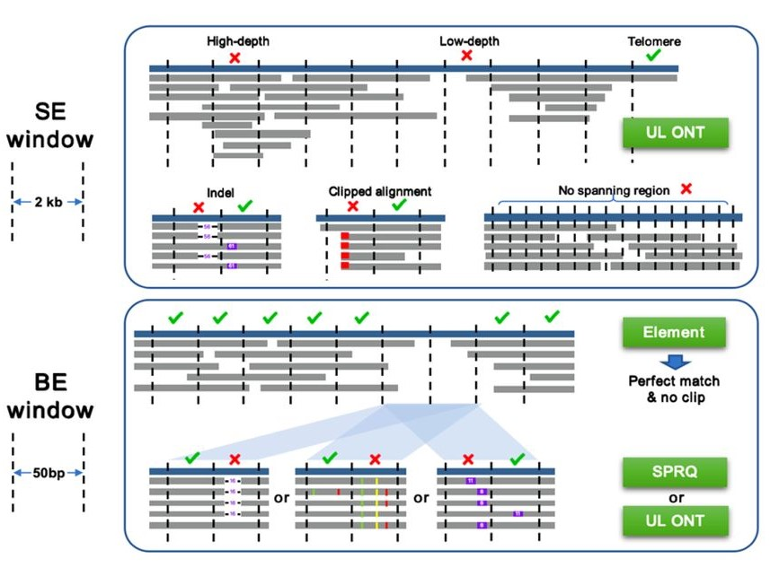

# SAS: an alignment-based metric for assembly errors

[](LICENSE)
[](https://www.python.org/)
[](src/_version.py)
[](https://github.com/KANGYUlab/sas-pipeline/actions/workflows/ci.yml)

SAS (Sufficient Alignment Support) evaluates genome assemblies by identifying
regions that lack sufficient support from mapped short reads, PacBio HiFi reads,
or Oxford Nanopore (ONT) reads. It reports base-level errors (BE), structural
errors (SE), genome-wide quality values, and per-chromosome summaries.

The default BE + SE workflow is optimized for fast whole-genome analysis. It
uses candidate-driven pileups, batched external-tool calls, parallel workers,
streaming I/O, and a single ordered spanning-read scan per chromosome instead
of repeatedly scanning the same alignments.

## Contents

- [How SAS works](#how-sas-works)
- [Requirements](#requirements)
- [Installation](#installation)
- [Quick start](#quick-start)
- [Command-line parameters](#command-line-parameters)
- [Helper programs](#helper-programs)
- [Performance and implementation notes](#performance-and-implementation-notes)
- [Output files](#output-files)
- [Testing](#testing)
- [Citation](#citation)

## How SAS works



**Figure 1. SAS detection principle.** Structural errors (SE) are evaluated in
2 kb windows using ultra-long ONT alignment depth, indels, clipping, and
spanning-read support. Base-level errors (BE) are evaluated in 50 bp windows
using perfectly aligned short reads and supporting HiFi or ultra-long ONT
evidence.

### Base-level errors (BE)

BE analysis begins with 50 bp candidate windows. Low-coverage short-read
windows are evaluated with HiFi and ONT pileup evidence. A window is retained
when the available technologies do not provide sufficient alignment support.

The standard support threshold is based on 10% of mean sequencing depth.
Terminal regions, compositionally biased repeats, and extreme-GC regions use
the project-specific adaptive rules implemented in `filter_be.py`.

### Structural errors (SE)

SE analysis evaluates 2 kb windows using filtered ONT alignments and combines:

- large insertions and deletions (default minimum: 50 bp);
- soft/hard clipping evidence;
- low- and high-depth anomalies;
- windows without a read spanning the complete spanning interval.

Internal windows and chromosome-terminal windows use different decision rules.
By default, the terminal region size is 10 kb. Spanning analysis uses 30 kb
windows at a 2 kb step and applies terminal correction before reporting merged
non-spanning intervals.

### Identical-region (IR) re-analysis

`--generate-ir` uses `genmap` to generate identical-region BED intervals from
parental haplotypes. SAS first searches for maternal/paternal FASTA files and can
otherwise split a diploid reference using recognized chromosome suffixes. The
generated `IR.bed` is re-analysed with HiFi and ONT evidence.
If `-a/--additional-bed-file` is supplied at the same time, SAS keeps both
sources and evaluates the union of low-coverage, user-provided, and generated
IR candidates; one source no longer replaces another.

For re-analysis, every IR interval is expanded into reference-aligned windows
of at most 50 bp. These windows are combined with the ordinary BE candidates,
sorted in reference order, and deduplicated by exact coordinates. Adjacent
windows are **not** merged: each 50 bp row remains an independent algorithmic
unit through HiFi/ONT pileup cleaning and evidence merging.

IR refinement is optional and does not affect the speed of the default workflow.
When enabled, it adds a `genmap` indexing/mapping phase and re-evaluates extra BE
candidates. Its additional runtime varies with assembly size, candidate count,
storage speed, and available CPU resources, so SAS does not assign a fixed
runtime estimate.

### Quality value

SAS reports a Phred-scaled assembly quality value:

```text
QV_SAS = -10 × log10((BE_windows + SE_windows) / assembly_length)
```

When no error windows are detected, QV is reported as infinity.

## Requirements

### Input data

- one coordinate-sorted short-read BAM;
- one coordinate-sorted PacBio HiFi BAM;
- one coordinate-sorted ONT BAM;
- the assembly/reference FASTA.

When `--skip-filter` is used, the supplied BAM files must already satisfy the
pipeline's filtering expectations and have usable BAM indexes.

### Software

SAS is intended for Linux and other POSIX environments with GNU Bash. Windows
users should run it under WSL2 or a Linux container; native Windows command
shells are not supported by the Bash helper programs.

- Python 3.8 or newer;
- `samtools`;
- `bedtools`;
- `mosdepth`;
- `genmap` only when using `--generate-ir`.

Core Python dependencies are listed in [requirements.txt](requirements.txt).
Before a run begins, SAS reports all missing command-line dependencies required
by the selected BE/SE/IR mode in one error message.

## Installation

### Recommended: Conda/Mamba plus local package install

```bash
git clone https://github.com/KANGYUlab/sas-pipeline.git
cd sas-pipeline

conda create -n sas-pipeline -c conda-forge -c bioconda \
  python=3.11 samtools bedtools mosdepth
conda activate sas-pipeline

python -m pip install .
```

Install `genmap` only when IR generation is required:

```bash
conda install -c conda-forge -c bioconda genmap
```

The package installs two console commands:

```text
sas-pipeline       complete BE + SE workflow
sas-se-analysis    standalone structural-error workflow
```

### Run directly from a clone

```bash
python -m pip install -r requirements.txt
python src/sas_pipeline.py --help
```

Shell helpers are launched explicitly with Bash by the pipeline, so executable
permission is not required for packaged installations.

### Optional dependencies

```bash
python -m pip install ".[viz]"   # plotting packages
python -m pip install ".[dev]"   # test and development packages
```

### Verify the installation

```bash
samtools --version
bedtools --version
mosdepth --version
sas-pipeline --version
sas-se-analysis --version
```

All SAS commands should report version `2.0.0`.

## Quick start

### Complete BE + SE analysis

```bash
sas-pipeline \
  -i illumina.bam \
  -H hifi.bam \
  -N ont.bam \
  -r reference.fa \
  -o results \
  -t 32
```

The equivalent long-form invocation remains supported:

```bash
sas-pipeline \
  --short-read-bam illumina.bam \
  --hifi-bam hifi.bam \
  --ont-bam ont.bam \
  --reference-fa reference.fa \
  --output-dir results \
  --threads 32
```

### BE analysis only

```bash
sas-pipeline -i illumina.bam -H hifi.bam -N ont.bam \
  -r reference.fa -o results --no-se-analysis
```

### SE analysis only with pre-filtered BAMs

```bash
sas-pipeline -i illumina.filtered.bam -H hifi.filtered.bam -N ont.filtered.bam \
  -r reference.fa -o results --skip-filter --no-be-analysis
```

### Add candidate or masking BED files

```bash
# Add BED regions to BE candidate generation.
sas-pipeline -i illumina.bam -H hifi.bam -N ont.bam \
  -r reference.fa -o results -a candidate_regions.bed

# Exclude intervals from final BE/SE results.
sas-pipeline -i illumina.bam -H hifi.bam -N ont.bam \
  -r reference.fa -o results -b centromeres.bed gaps.bed
```

### Generate identical regions

```bash
sas-pipeline -i illumina.bam -H hifi.bam -N ont.bam \
  -r reference.fa -o results --generate-ir
```

## Command-line parameters

Run `sas-pipeline -h` to print the same reference from the installed version.

### Required inputs

| Short | Long | Value | Description |
|---|---|---|---|
| `-i` | `--short-read-bam` | `BAM` | Short-read BAM file. |
| `-H` | `--hifi-bam` | `BAM` | PacBio HiFi BAM file. |
| `-N` | `--ont-bam` | `BAM` | Oxford Nanopore BAM file. |
| `-r` | `--reference-fa` | `FASTA` | Assembly/reference FASTA. |
| `-o` | `--output-dir` | `DIR` | Output root containing `final/`, `work/`, `logs/`, and `metadata/`. |

### General options

| Short | Long | Value/default | Description |
|---|---|---|---|
| `-f` | `--reference-fai` | `FAI` / auto | Existing FASTA index; generated when omitted. |
| `-t` | `--threads` | `N` / `8` | Threads available to `samtools` and `mosdepth`. |
|  | `--pileup-workers` | `N` / `min(threads, 16)` | Concurrent HiFi/ONT mpileup batches; lower this if memory or storage is saturated. |
|  | `--se-workers` | `N` / `min(threads, 8)` | Concurrent SE chromosome/spanning workers. |
|  | `--scripts-dir` | `DIR` / packaged path | Override helper-script directory. |
|  | `--src-dir` | `DIR` / packaged path | Override Python source directory. |
|  | `--skip-filter` | flag | Use the supplied BAM files without filtering. |
|  | `--no-be-analysis` | flag | Skip BE analysis. |
|  | `--no-se-analysis` | flag | Skip SE analysis. |
|  | `--version` | flag | Print the version and exit. |
| `-h` | `--help` | flag | Print help and exit. |

At least one of BE or SE analysis must remain enabled.

### BE and masking options

| Short | Long | Value | Description |
|---|---|---|---|
| `-b` | `--bed-files` | `BED [BED ...]` | Mask one or more BED files from final results. |
| `-a` | `--additional-bed-file` | `BED` | Split additional candidates into 50 bp windows and merge them with low-coverage candidates. |
| `-g` | `--generate-ir` | flag | Run optional IR refinement with `genmap`; adds preprocessing and extra BE candidates. |

### SE options

| Long | Default | Description |
|---|---:|---|
| `--se-window-size BP` | `2000` | SE analysis window size. |
| `--se-min-indel-length BP` | `50` | Minimum insertion/deletion length. |

All numeric size, thread, process, and count options reject zero or negative
values unless the option explicitly allows zero (for example, mpileup batch
gap).

## Helper programs

Every helper supports `-h`/`--help` and `--version`. Existing long options and
positional argument order are preserved for compatibility.

| Program | Invocation | Purpose |
|---|---|---|
| `filter_bam.sh` | `MODE -i INPUT_BAM -o OUTPUT_BAM [OPTIONS]` | Filter short- or long-read alignments. |
| `smallerror_short.sh` | `-i INPUT_BAM -o PREFIX [-t N]` | Generate low-coverage 50 bp candidates. |
| `smallerror_long.py` | `BED BAM FASTA OUTPUT [OPTIONS]` | Evaluate candidates with long-read pileups. |
| `merge_pileup.py` | `BED HIFI_DATA ONT_DATA FASTA OUTPUT` | Merge HiFi/ONT evidence and calculate sequence composition. |
| `filter_be.py` | `DATA FAI [-o FILE] [-e] [-s SEP]` | Apply final BE rules; separators include `tab`, `comma`, `space`, and `pipe`. |
| `spanning.py` | `BAM FAI -o PREFIX [-w BP] [-s BP] [-p N]` | Detect and merge non-spanning windows. |
| `sas-se-analysis` | `BAM FASTA PREFIX [OPTIONS]` | Run SE analysis independently. |

Examples:

```bash
bash scripts/filter_bam.sh long-read -i ont.bam -o ont.filtered.bam -t 16

python scripts/smallerror_long.py candidates.bed hifi.bam reference.fa hifi.txt \
  -p 16 -g 10000 -S 1000000 -n 1000

sas-se-analysis ont.filtered.bam reference.fa sample \
  -d se_results -w 2000 -m 50 -t 16 --workers 8
```

## Performance and implementation notes

The standard workflow is the speed-oriented path: `-t/--threads` accelerates
external tools, BE analysis limits long-read pileups to candidate regions, and
SE spanning analysis avoids repeated random BAM queries. Heavy mpileup and SE
tasks have separate conservative worker limits, preventing a high thread value
from launching enough processes to saturate memory or random I/O. These changes
reduce process-launch overhead, disk traffic, and redundant alignment scans on
whole-genome datasets.

### Batched mpileup

`smallerror_long.py` does not start one `samtools mpileup` process per 50 bp
candidate. It groups candidates on the same chromosome using these defaults:

- maximum gap between adjacent candidates: 10 kb;
- maximum complete batch span: 1 Mb;
- maximum original intervals per batch: 1,000.

Each batch uses both a genomic range and a BED target list. Pileup rows are then
dispatched back to the original BED intervals, including overlapping intervals,
without leaking positions from gaps between candidates. The 1 Mb and 1,000-row
limits control only how many windows share one `mpileup` query; they never turn
adjacent 50 bp windows into a longer analysis interval. Therefore a dense IR
block may share a query for speed while every 50 bp window is still evaluated
separately.

For the pipeline-generated candidate sets, every row reaching this stage is at
most 50 bp, so the 1 Mb batch-span limit is effective. In standalone use, an
input BED row longer than 1 Mb remains one algorithmic interval and is not split
silently; only additional rows are prevented from joining that batch.

The batch output is written once to a shared spool with byte offsets for each
window, then post-processed window by window. Final records are also staged once
per batch and merged back into original BED order. This avoids creating two
temporary files for every 50 bp candidate.

### Bounded memory and file descriptors

- indexed batch-result merging uses bounded fan-in and fixed memory;
- HiFi/ONT evidence is joined through a temporary SQLite database instead of
  loading all candidate and evidence rows into Python dictionaries;
- reference composition uses a bounded 1 Mb sequential FASTA cache, avoiding
  one indexed FASTA lookup for every dense 50 bp IR window;
- final BE filtering reads the merged table in 100,000-row chunks and publishes
  the result atomically;
- complete command output is written to per-stage log files while only a bounded
  diagnostic tail is retained by the pipeline process;
- per-chromosome output writers use a bounded LRU file-handle pool;
- SE window counters are stored sparsely and zero windows are synthesized only
  when output is written.

### BAM access

Spanning analysis scans each chromosome once and evaluates its ordered windows
in one pass. This avoids one random BAM fetch for every window while retaining
the original full-span predicate.

### Failure safety

Intermediate data is written in private run directories. Related public outputs
(for example FASTA/FAI pairs and paired spanning BED files) are published as a
set with rollback, so a failed replacement does not leave mixed old/new files.

Actual runtime depends on assembly size, coverage, storage latency, candidate
count, and thread allocation. Optional IR refinement adds one `genmap` phase
and extra candidate evaluation; the default BE + SE workflow skips that work
and remains the recommended fast path for routine analysis.

## Coordinate conventions

- BED inputs and BED outputs use 0-based, half-open intervals.
- SE `.tsv` window/anomaly coordinates are 1-based and closed.
- Masking converts coordinate systems explicitly before overlap checks.

## Configuration template

[config/config_template.json](config/config_template.json) documents the
configuration written to `metadata/pipeline_config.json`. The main program currently
accepts command-line options; it does not load this JSON file as a CLI config.
Standalone-only mpileup batch geometry options appear in `smallerror_long.py -h`
rather than the configuration template.

## Output files

SAS separates compact deliverables from large intermediate files. For most
downstream work, use only `final/`. The tree below is the **maximum possible
successful-run output set**; disabled analyses and unused options omit their
conditional files and directories.

```text
results/
+-- final/                                         # compact files to archive/share
|   +-- sas_pipeline_summary.txt                   # genome-wide run/QV report
|   +-- chromosome_qv_summary.txt                  # per-chromosome BE/SE/QV report
|   +-- be/                                        # only when BE is enabled
|   |   +-- final_be_results.txt                   # stable final BE table
|   |   +-- IR.bed                                 # only with --generate-ir
|   |   `-- by_chromosome/
|   |       +-- be_results_chr1.txt                # one file per chromosome with BE rows
|   |       +-- be_results_chr2.txt
|   |       `-- be_results_<chromosome>.txt
|   `-- se/                                        # only when SE is enabled
|       +-- structural_errors.bed                  # merged final SE intervals
|       +-- anomalous_regions.tsv                  # detailed final SE windows
|       +-- anomaly_summary.tsv                    # SE tag counts by chromosome
|       `-- by_chromosome/
|           +-- se_results_chr1.txt                # one file per chromosome with SE rows
|           +-- se_results_chr2.txt
|           `-- se_results_<chromosome>.txt
|
+-- work/                                          # intermediates and diagnostics
|   +-- alignments/                                # omitted with --skip-filter
|   |   +-- short_read_filtered.bam                 # only when BE is enabled
|   |   +-- short_read_filtered.bam.bai             # only when BE is enabled
|   |   +-- hifi_filtered.bam                       # only when BE is enabled
|   |   +-- hifi_filtered.bam.bai                   # only when BE is enabled
|   |   +-- ont_filtered.bam
|   |   `-- ont_filtered.bam.bai
|   |
|   +-- be/                                        # only when BE is enabled
|   |   +-- smallerror_short.genome                # chromosome sizes from BAM header
|   |   +-- smallerror_short.windows.bed           # all 50 bp reference windows
|   |   +-- smallerror_short.mosdepth.global.dist.txt
|   |   +-- smallerror_short.mosdepth.summary.txt
|   |   +-- smallerror_short.per-base.bed.gz       # short-read per-base depth
|   |   +-- smallerror_short.per-base.bed.gz.csi   # mosdepth index, version-dependent
|   |   +-- smallerror_short.low_coverage_bases.bed
|   |   +-- smallerror_short.smallerror.bed        # helper's candidate BED
|   |   +-- smallerror_short.smallerror.summary.txt
|   |   +-- smallerror.bed                         # normalized pipeline candidate BED
|   |   +-- smallerror_masked.bed                  # only with --bed-files
|   |   +-- smallerror_50bp_windows.bed            # with -a or --generate-ir
|   |   +-- additional_bed_windows.bed             # only with -a
|   |   +-- ir_50bp_windows.bed                     # only with --generate-ir
|   |   +-- candidate_50bp_windows.bed             # sorted/deduplicated; every row remains <=50 bp
|   |   +-- candidate_50bp_windows.unmasked.bed    # extra candidates plus --bed-files only
|   |   +-- hifi_filtered_regions.txt              # HiFi pileup evidence
|   |   +-- ont_filtered_regions.txt               # ONT pileup evidence
|   |   +-- merged_results.txt                     # merged HiFi/ONT evidence
|   |   +-- final_be_results.unmasked.txt          # only with --bed-files
|   |   `-- ir_generation/                         # --generate-ir private work root;
|   |                                               # normally empty after run cleanup
|   |
|   `-- se/                                        # only when SE is enabled
|       +-- structural_errors.regions.bed.gz       # 2 kb mosdepth regions
|       +-- structural_errors.regions.bed.gz.csi   # mosdepth index, version-dependent
|       +-- structural_errors.mosdepth.global.dist.txt
|       +-- structural_errors.mosdepth.region.dist.txt
|       +-- structural_errors.mosdepth.summary.txt
|       +-- structural_errors.non_spanning.bed
|       +-- structural_errors.non_spanning_regions.merged.bed
|       +-- structural_errors.window_stats.tsv
|       +-- structural_errors.anomalous_regions.tsv
|       +-- structural_errors.anomalous_regions.bed
|       +-- structural_errors.result.bed
|       +-- structural_errors.anomaly_summary.tsv
|       +-- se.regions.bed.gz                      # compatibility alias
|       +-- se.regions.bed.gz.csi                  # compatibility alias, if present
|       +-- se.mosdepth.global.dist.txt             # compatibility alias
|       +-- se.mosdepth.region.dist.txt             # compatibility alias
|       +-- se.mosdepth.summary.txt                 # compatibility alias
|       +-- se.non_spanning.bed                     # compatibility alias
|       +-- se.non_spanning_regions.merged.bed      # compatibility alias
|       +-- se.window_stats.tsv                     # compatibility alias
|       +-- se.anomalous_regions.tsv                # compatibility alias
|       +-- se.anomalous_regions.bed                # compatibility alias
|       +-- se.result.bed                           # compatibility alias
|       +-- se.anomaly_summary.tsv                  # compatibility alias
|       +-- se.anomalous_regions_masked.tsv         # only with --bed-files
|       +-- structural_errors.result_masked.bed     # only with --bed-files
|       `-- structural_errors.anomaly_summary_masked.tsv
|                                                    # only with --bed-files
|
+-- logs/
|   +-- sas_pipeline.log                            # pipeline-level commands/diagnostics
|   `-- stages/
|       +-- 001_<stage>.stdout.log                  # complete stdout for each command
|       +-- 001_<stage>.stderr.log                  # complete stderr for each command
|       +-- 002_<stage>.stdout.log
|       +-- 002_<stage>.stderr.log
|       `-- ...                                     # one numbered pair per command
|
`-- metadata/
    `-- pipeline_config.json                        # resolved run configuration
```

Final filenames stay stable when BED masking is enabled; the files in `final/`
contain the masked results. Detailed unmasked and diagnostic data remain under
`work/`. The `se.*` entries are compatibility hard links (or symlinks when hard
links are unavailable), so they normally do not duplicate the underlying file
data. Mosdepth may add or omit compressed-file index files depending on its
installed version.

The `by_chromosome/` directories contain files only for chromosomes that have
at least one result row. Therefore an error-free chromosome does not produce an
empty `be_results_*` or `se_results_*` file.

`work/` is intentionally not a public result interface: its filenames may
change as the implementation evolves. Keep it when troubleshooting or when a
full audit trail is required; otherwise `final/`, `logs/`, and `metadata/` are
the useful deliverables. SAS does not delete files from the older flat layout
when an existing output directory is reused, so use a new output directory to
get a completely clean tree.

## Testing

Run the complete regression suite:

```bash
python -m unittest discover -s tests -v
```

GitHub Actions runs the same suite on Python 3.8, 3.11, and 3.13 and builds the
release artifacts on Python 3.11.

Build and inspect release artifacts:

```bash
python -m pip install build
python -m build
```

The tests cover CLI help/version output, batching and interval dispatch,
streaming I/O, coordinate boundaries, empty inputs, cross-platform shell
behavior, transactional publication, packaging, and installation layout.

## Citation

If you use SAS, please cite:

Yanan Chu, Zhuo Huang, Changjun Shao, Shuming Guo, Xinyao Yu, Jian Wang,
Yabin Tian, Jing Chen, Ran Li, Yukun He, Jun Yu, Jie Huang, Zhancheng Gao and
Yu Kang. *Approaching an Error-Free Diploid Human Genome Assembly of East Asian
Origin*. bioRxiv. [https://doi.org/10.1101/2025.08.01.667781](https://doi.org/10.1101/2025.08.01.667781)

## License

This project is distributed under the [MIT License](LICENSE).
